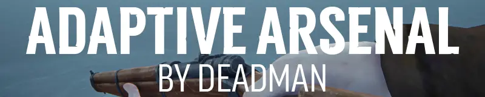

    

Adaptive Arsenal is a [MelonLoader](https://github.com/LavaGang/MelonLoader) mod for [The Long Dark](https://www.hinterlandgames.com/the-long-dark/) that makes its rifles and revolvers feel more real. Bullets fly through the air instead of hitting instantly, and where they land depends on your skill, your stance and how far away the target is.

## Install

1. Install [MelonLoader](https://github.com/LavaGang/MelonLoader/releases/latest/download/MelonLoader.Installer.exe) into The Long Dark.
2. Install the mods it needs, in the `Mods` folder in the game's folder:
   - [Complex Logger](https://github.com/Arkhorse/Complex-Logger/releases/latest)
   - [ModSettings](https://github.com/DigitalzombieTLD/ModSettings), for the mod's settings menu (Complex Logger needs it too)
3. Download [AdaptiveArsenal.dll](https://github.com/Deaadman/adaptive-arsenal/releases/latest/download/AdaptiveArsenal.dll) and put it in the `Mods` folder too.
4. Start the game.

To update, replace `AdaptiveArsenal.dll` with the new one. To uninstall, delete it.

Each release says which version of The Long Dark it was made for. After a game update, the mod may not work until it's updated too.

### Doesn't work with

- [Target Practice & Master Hunter](https://github.com/RomainDeschampsFR/TargetPracticeAndMasterHunter). Both change how bullets work, so the mod won't load alongside it.

### Nightly builds

Every change is built straight away and published as the [nightly release](https://github.com/Deaadman/adaptive-arsenal/releases/tag/nightly). It has the newest fixes and features, but it may be unstable. Back up your saves first.

## What it does

| Feature | What changes |
| --- | --- |
| Real bullets | Bullets are projectiles that take time to reach their target, instead of hitting the instant you fire |
| Accuracy | Your skill, crouching or standing, moving, and firing from the hip all change how close a shot lands to where you aimed |
| Muzzle velocity | Each rifle and revolver fires its bullets at its own speed |
| Damage drop-off | The further a bullet travels, the less damage it does |
| Bullet trails | A trail follows each bullet, so you can see where it landed |
| Hidden ammo count | The HUD doesn't show how many rounds are loaded, so you keep count yourself |
| HUD animation | With the ammo count shown, firing plays an animation of the spent round on the ammo display |
| Revolver movement | You can walk while aiming a revolver |
| Settings | Turn real bullets, trails, revolver movement and the ammo count on or off, and tune accuracy, speed and damage, in the game's Mod Settings menu |

[How it all works](docs/features.md) has the numbers for each weapon.

## Bugs and ideas

Found a bug? Use the [bug report form](https://github.com/Deaadman/adaptive-arsenal/issues/new?template=bug_report.yml). It asks for `MelonLoader\Latest.log` from your game's folder, with every level turned on in Complex Logger's settings.

Have an idea? Use the [feature request form](https://github.com/Deaadman/adaptive-arsenal/issues/new?template=feature_request.yml).

## Learn more

- [How it works](docs/features.md): accuracy, muzzle velocities and damage, in numbers
- [Building from source](docs/development.md)
- [Changelog](CHANGELOG.md)

## License

Adaptive Arsenal is licensed under [GPL-3.0](LICENSE).

## Disclaimers

**AI assistance.** Parts of this project, including some of its code, were written with the help of AI coding agents.

**Not affiliated with Hinterland.** Adaptive Arsenal is an unofficial fan-made mod. It isn't made, endorsed or supported by Hinterland Studio. The Long Dark and its assets are the property of Hinterland Studio. Please report problems with the mod here, not to Hinterland.
